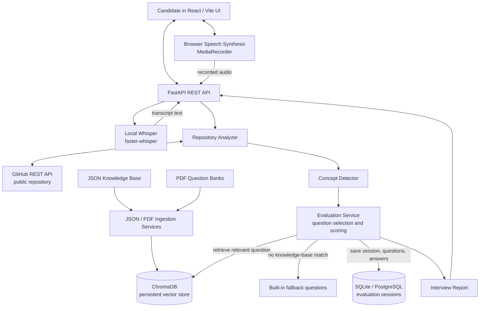

# CODE_VIVA

CODE_VIVA is a web application for running technical interviews grounded in a
candidate's public GitHub repository and a local interview knowledge base.
It analyzes repository metadata and source files, detects relevant concepts,
retrieves matching questions from ChromaDB, and presents a ten-question
interview with answer scores, feedback, and a final report. Candidates can type
answers or use supported browser speech features.

## Features

- **GitHub repository analysis:** Fetches public repository metadata, README
  content, and a bounded selection of source/configuration files.
- **Concept detection:** Uses repository code, README text, description, and
  GitHub topics to identify technologies such as Python, machine learning,
  RAG, frontend, backend, databases, and DevOps. Repository contents select
  interview subjects only; candidates are not quizzed on their source code.
- **Knowledge-base RAG:** Indexes JSON Q&A datasets and PDF question banks in a
  persistent ChromaDB store, then retrieves questions by detected concept.
- **Adaptive fundamentals interview:** Selects ten conceptual questions from
  the supplied knowledge base, starts at easy, and progresses through medium
  and hard. Strong answers trigger a harder follow-up on the same topic; weak
  answers revisit that topic at a more foundational level. Every detected
  concept gets a question before the interview repeats concepts for adaptive
  follow-ups. Related questions may be combined, and built-in fallbacks also
  ask about fundamentals—not code or project implementation.
- **Answer evaluation:** Scores answers and returns feedback, then builds a
  session report with overall score, readiness, strong areas, and weak areas.
- **Interactive report:** Shows detected concepts and their coverage, with
  expandable per-concept results and per-answer feedback.
- **Voice interaction:** Browser speech synthesis can read questions aloud;
  recorded answers are transcribed by the backend's local Whisper model and
  placed in the editable answer field. No paid speech API is used.
- **Persistent sessions:** Stores students, repositories, interview questions,
  answers, and reports in SQLite by default, with PostgreSQL also supported.
- **Knowledge-base operations:** API endpoints trigger indexing and report
  JSON/PDF question-bank statistics.

## Architecture



### Interview request flow

1. The frontend sends the candidate's name, email, and GitHub URL to
   `POST /api/v1/evaluations`.
2. The backend fetches the public repository profile and selected files from
   GitHub, then uses repository signals to select relevant subject areas. It
   does not generate questions about the candidate's code.
3. The evaluation service searches the JSON question collection in ChromaDB
   for an unused fundamental question at the planned difficulty and topic. It
   next tries the PDF question collection, then concept-level built-in
   questions and neutral fundamentals-only prompts.
4. The question and session are saved to the relational database and returned
   to the frontend.
5. The candidate types an answer or records it in the browser. The backend
   transcribes the audio locally with Whisper; the transcript can be edited
   before submission.
6. The backend evaluates the answer, stores its score and feedback, and adapts
   the next question. Every detected concept is covered once before adaptive
   follow-ups begin. Strong answers increase difficulty while staying on the
   same topic; weak answers revisit the topic at an easier level. After ten
   answers, it marks the interview complete and generates a concept coverage
   report with expandable answer details.

### Knowledge-base indexing and retrieval

- With `CHROMA_ENABLED=true`, every `knowledge_base/*.json` file is parsed on
  backend startup and **upserted** into the `json_question_bank` Chroma
  collection. This supports both top-level JSON arrays and dataset objects
  with an `items` array.
- PDF files are ingested through the admin ingestion endpoint into the
  `question_bank` collection. PDF question extraction recognizes numbered
  questions and `[Easy]`, `[Medium]`, and `[Hard]` difficulty markers.
- JSON records may provide a topic, answer, evaluation points, example,
  interview tip, and difficulty. Missing difficulty is inferred by the
  ingestion service.
- The supplied
  [`machine_learning_interview_qa(1).json`](./knowledge_base/machine_learning_interview_qa(1).json)
  contains 61 ML question-and-answer records. The ingester recognizes its
  `items` wrapper and categorizes its records as `machine_learning`.
- Re-ingestion is safe for JSON files: stable IDs are upserted so entries can
  be refreshed without creating duplicate records.

## Technology Stack

| Area | Technologies |
|---|---|
| Frontend | React 18, TypeScript, Vite |
| Backend API | Python 3.11+, FastAPI, Pydantic |
| Relational storage | SQLAlchemy, SQLite by default, PostgreSQL supported |
| Vector search | ChromaDB with persistent local storage |
| Repository analysis | GitHub REST API, `httpx`, regular-expression concept signals |
| Knowledge ingestion | JSON, `pypdf` for PDFs |
| Voice | Browser Speech Synthesis and MediaRecorder; backend `faster-whisper` transcription |

## Repository Layout

```text
.
├── backend/
│   ├── app/
│   │   ├── api/v1/router.py                 # REST endpoints
│   │   ├── services/
│   │   │   ├── concept_detector.py           # Repository concept detection
│   │   │   ├── evaluation_service.py         # Sessions, questions, scoring, reports
│   │   │   ├── github_analyzer.py            # Public GitHub repository analysis
│   │   │   ├── json_kb_ingestion_service.py  # JSON parse, index, retrieve
│   │   │   ├── llm_service.py                # OpenAI-compatible question-generation utility
│   │   │   ├── pdf_ingestion_service.py      # PDF question extraction and retrieval
│   │   │   └── rag_service.py                # Repository-code ChromaDB utilities
│   │   ├── config.py                         # Environment-backed settings
│   │   ├── db.py                             # SQLAlchemy engine/session
│   │   ├── main.py                           # FastAPI app and startup indexing
│   │   ├── models.py                         # Student, repository, interview session
│   │   └── schemas.py                        # API request and response schemas
│   ├── requirements.txt
│   └── tests/
│       └── test_api.py
├── frontend/
│   ├── src/
│   │   ├── App.tsx                           # Interview UI and browser voice controls
│   │   ├── index.css                         # Application styles
│   │   └── main.tsx                          # React entry point
│   ├── package.json
│   └── vite.config.ts
├── knowledge_base/                           # JSON Q&A banks and PDF sources
├── .env.example
├── docker-compose.yml                        # Optional PostgreSQL service
└── README.md
```

## Requirements

- Python 3.11 or newer
- Node.js 18 or newer and npm
- Git
- Internet access for GitHub repository analysis

The default configuration uses SQLite and a local persistent ChromaDB directory;
PostgreSQL and an OpenAI-compatible LLM endpoint can be configured optionally.

## Local Development

Run commands from the repository root unless noted otherwise.

### 1. Configure the backend

Create and activate a virtual environment, install dependencies, and copy the
sample environment file:

**Windows PowerShell**

```powershell
py -3.11 -m venv venv
.\venv\Scripts\Activate.ps1
python -m pip install -r backend\requirements.txt
Copy-Item .env.example .env
```

**macOS / Linux**

```bash
python3.11 -m venv venv
source venv/bin/activate
python -m pip install -r backend/requirements.txt
cp .env.example .env
```

Start the API server:

```bash
python -m uvicorn backend.app.main:app --reload --host 0.0.0.0 --port 8000
```

The FastAPI application creates relational database tables at startup. It
ingests JSON knowledge-base files into Chroma only when `CHROMA_ENABLED=true`.
OpenAPI/Swagger documentation is available at `http://localhost:8000/docs`.

### 2. Configure and run the frontend

In a second terminal:

```bash
cd frontend
npm install
npm run dev
```

Open `http://localhost:5173`. The frontend currently sends API requests to
`http://localhost:8000/api/v1`.

### 3. Optional PostgreSQL

The Compose file starts PostgreSQL 16 on port `5432`:

```bash
docker compose up -d postgres
```

Set `DATABASE_URL` in `.env` to the PostgreSQL connection string for your
environment. The default app configuration is SQLite and does not require
Docker.

## Configuration

Set values in the root `.env` file. `.env` is ignored by Git; do not commit
secrets.

| Variable | Default | Purpose |
|---|---|---|
| `DATABASE_URL` | `sqlite:///./evaluator.db` | SQLAlchemy database connection |
| `APP_ENV` | `development` | Environment label returned by `/health` |
| `CORS_ORIGINS` | `http://localhost:5173` | Comma-separated allowed frontend origins |
| `GITHUB_TOKEN` | Empty | Optional GitHub token setting; repository analyzer currently supports public repositories |
| `LLM_PROVIDER` | `groq` | Provider label for LLM configuration |
| `LLM_MODEL` | `llama3-8b-8192` | Model name used by the OpenAI-compatible LLM utility |
| `LLM_API_KEY` | Empty | API key used by the LLM utility when calling a compatible endpoint |
| `LLM_BASE_URL` | Empty | Optional OpenAI-compatible API base URL; defaults to Groq's API in the LLM utility |
| `CHROMA_ENABLED` | `false` | Enable Chroma vector indexing and retrieval (uses extra memory) |
| `CHROMA_PERSIST_DIR` | `./.chroma` | Persistent vector-store directory |
| `LIVEKIT_URL`, `LIVEKIT_API_KEY`, `LIVEKIT_API_SECRET` | Empty | Reserved LiveKit configuration |
| `STT_LANGUAGE` | Empty | Optional language hint for Whisper, such as `en` or `hi`; auto-detected when empty |
| `STT_MODEL`, `TTS_MODEL`, `TTS_VOICE` | Empty | Reserved speech configuration |
| `WHISPER_MODEL` | `tiny` | Whisper model size downloaded by the backend for speech transcription |
| `VITE_API_BASE_URL` | `http://localhost:8000/api/v1` | Frontend build-time variable; set in the frontend environment/Render Static Site, not the backend `.env` |

When enabled, ChromaDB stores its local index in `.chroma/` by default. That
directory is ignored by Git and may be regenerated by re-ingesting the
knowledge base. When disabled, interviews use built-in fallback questions.

## Knowledge Base Format

Add JSON files under `knowledge_base/`. Both a top-level array and a wrapped
dataset object are supported.

**Top-level array**

```json
[
  {
    "id": 1,
    "topic": "FastAPI",
    "question": "How does dependency injection work in FastAPI?",
    "expected_answer": "FastAPI resolves declared dependencies for a request, enabling shared logic such as database sessions and authentication.",
    "evaluation_points": [
      "Explains dependency injection",
      "Mentions Depends",
      "Connects dependencies to reusable request-scoped logic"
    ],
    "difficulty": "medium"
  }
]
```

**Wrapped dataset**

```json
{
  "dataset_name": "database_interview_qa",
  "items": [
    {
      "id": "db_001",
      "topic": "Databases",
      "question": "What is an index?",
      "answer": "An index is a data structure that helps a database find rows more efficiently.",
      "difficulty": "easy"
    }
  ]
}
```

Supported aliases include `question`/`q`, `expected_answer`/`answer`/`a`,
`topic`/`concept`/`category`, and `evaluation_points`/`eval_points`/`key_points`.
`difficulty` may be `easy`, `medium`, or `hard`; it is optional.

For PDF sources, add `.pdf` files under `knowledge_base/`. Use numbered question
lines and optional `[Easy]`, `[Medium]`, or `[Hard]` section markers for best
results. JSON ingestion runs at backend startup; use the admin endpoints below
to re-index while the server is running.

## API Reference

All application endpoints are prefixed with `/api/v1`.

| Method | Endpoint | Description |
|---|---|---|
| `GET` | `/health` | Service health and configured environment |
| `GET` | `/api/v1/health` | API router health |
| `POST` | `/api/v1/evaluations` | Analyze a GitHub repository and start an interview |
| `GET` | `/api/v1/evaluations/{session_id}/analysis` | Retrieve the repository profile and analysis |
| `POST` | `/api/v1/evaluations/{session_id}/next-question` | Return/create the current interview question |
| `POST` | `/api/v1/evaluations/{session_id}/answer` | Score and save an answer, then return the next question |
| `POST` | `/api/v1/voice/transcription` | Transcribe a multipart audio recording using local Whisper |
| `GET` | `/api/v1/evaluations/{session_id}` | Retrieve the evaluation session |
| `GET` | `/api/v1/evaluations/{session_id}/report` | Retrieve or build the final session report |
| `POST` | `/api/v1/admin/ingest-json-kb` | Re-index JSON knowledge-base files in the background |
| `POST` | `/api/v1/admin/ingest-knowledge-base` | Re-index JSON and PDF knowledge-base files in the background |
| `GET` | `/api/v1/admin/knowledge-base-stats` | Get JSON and PDF vector-bank statistics |

### Start an evaluation

```json
{
  "student": {
    "name": "Ada Student",
    "email": "ada@example.com"
  },
  "repository": {
    "url": "https://github.com/owner/repository"
  }
}
```

### Submit an answer

```json
{
  "answer": "A written answer or browser-transcribed speech."
}
```

The answer endpoint returns the evaluation label, a `0`–`100` score, feedback,
and the next question (or `null` when the ten-question interview is complete).

The voice transcription endpoint accepts an `audio` multipart file field
(supported containers include WebM, MP4, Ogg, WAV, and MP3) and returns
`{"text": "recognized speech"}`. Recordings are limited to 20 MB.

## Voice Mode

Question playback uses the browser's built-in Speech Synthesis API. For spoken
answers, the browser records audio with `MediaRecorder` and uploads it as
multipart audio to `POST /api/v1/voice/transcription`. The backend transcribes
the recording locally using `faster-whisper` on CPU (`int8`) and returns text.
The transcript is appended to the answer field, where it can be reviewed or
edited before submission.

- **Turn voice mode on** reads the current question and subsequent questions.
- **Read question aloud** plays the current question on demand.
- **Answer by voice** starts microphone recording; **Stop recording** sends the
  captured audio for transcription.

Microphone recording requires browser support and user permission. Production
sites must use HTTPS; `localhost` is allowed for development. Audio is
transmitted as a binary multipart upload rather than base64, which avoids
base64's size overhead. If recording or transcription fails, the answer can
still be typed into the same field.

### Deploying on Render

The backend is containerized by the root [`Dockerfile`](./Dockerfile).
Create a Render **Web Service**, connect this repository, and select **Docker**
as the runtime. Set the Dockerfile path to `./Dockerfile` (the repository
root). Render builds and runs the image; do not enter separate pip build/start
commands.

Configure these backend environment variables in Render (never bake secrets
into the Docker image):

- `APP_ENV=production`
- `DATABASE_URL`: create a Render PostgreSQL database and use its **Internal
  Database URL**, changing the scheme from `postgres://` or `postgresql://` to
  `postgresql+psycopg://` for this project's Psycopg 3 driver.
- `CORS_ORIGINS`: the exact deployed frontend origin, for example
  `https://your-frontend.onrender.com` (no path or trailing slash). Multiple
  origins can be comma-separated.
- `CHROMA_ENABLED=false` to prevent Chroma from downloading its embedding
  model and exceeding the 512 MB instance memory limit. Built-in interview
  questions remain available; vector knowledge-base retrieval is disabled.
- `WHISPER_MODEL=tiny` to use the smallest default Whisper model.
- `STT_LANGUAGE` if interviews should transcribe a known language rather than
  asking Whisper to detect it.

The Whisper model cache is placed under `/var/data`. Attach a Render persistent
disk mounted at `/var/data` if the downloaded model should survive restarts and
deployments. Without a disk, the cache is ephemeral and Whisper may download
its model again. A persistent disk can affect service availability and may
require a paid Render plan.

To build and run the same image locally from the repository root:

```bash
docker build -t code-viva-backend .
docker run --rm -p 8000:8000 --env-file .env code-viva-backend
```

Check `http://localhost:8000/health` for `{"status":"ok", ...}`. The
`.dockerignore` excludes `.env`, local databases, and local Chroma data from the
image. Keep database credentials in Render's environment settings and do not
commit `.env`.

Deploy `frontend/` as a Render **Static Site**:

- **Root directory:** `frontend`
- **Build command:** `npm install && npm run build`
- **Publish directory:** `dist`
- Set `VITE_API_BASE_URL` to the backend URL ending in `/api/v1`, for example
  `https://your-api.onrender.com/api/v1`.
- Include the frontend's exact Render URL in the backend `CORS_ORIGINS` value.

The image uses one Uvicorn worker, limits numerical-library threading, and
loads the Whisper runtime/model only when speech transcription is requested.
With Chroma disabled, this avoids the embedding-model download seen in the
failed deployment. This reduces memory use but does not guarantee the entire
service stays below 512 MB: Whisper transcription can still temporarily use
additional memory. Keep `WHISPER_MODEL=tiny`; if transcription cannot load
within the available memory, the endpoint returns an error and candidates can
type their answers instead. The Docker image size is not a limit on runtime
memory.

## Evaluation Notes

Answer evaluation in `EvaluationService.score_answer` is currently a lightweight
keyword/reasoning-marker heuristic, not an LLM-based assessment. It returns a
score, verdict, and generic improvement feedback. The question bank stores
reference answers and optional evaluation points, but this scoring method does
not currently compare responses against those reference answers. Treat scores
as developmental guidance rather than a hiring decision.

The repository includes an OpenAI-compatible LLM utility for grounded question
generation, but the current evaluation flow selects retrieved or built-in bank
questions. Configuring an LLM key alone does not switch the current interview
flow to LLM-generated questions or LLM grading.

## Testing and Build

Run the backend tests from the repository root:

```bash
python -m pytest backend/tests -q
```

Build and type-check the frontend:

```bash
cd frontend
npm run build
```

## Contributing

1. Create a branch for your change.
2. Keep API schemas and documentation in sync with behavior.
3. Add focused tests for backend behavior or data ingestion changes.
4. Run the relevant backend tests and frontend build.
5. Open a pull request with a concise description of the change.

## License

This project is licensed under the MIT License. See [LICENSE](./LICENSE).
